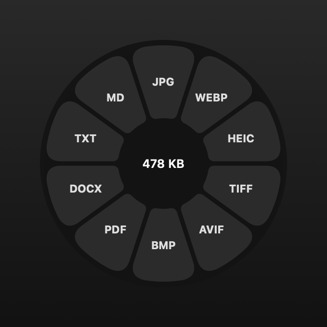
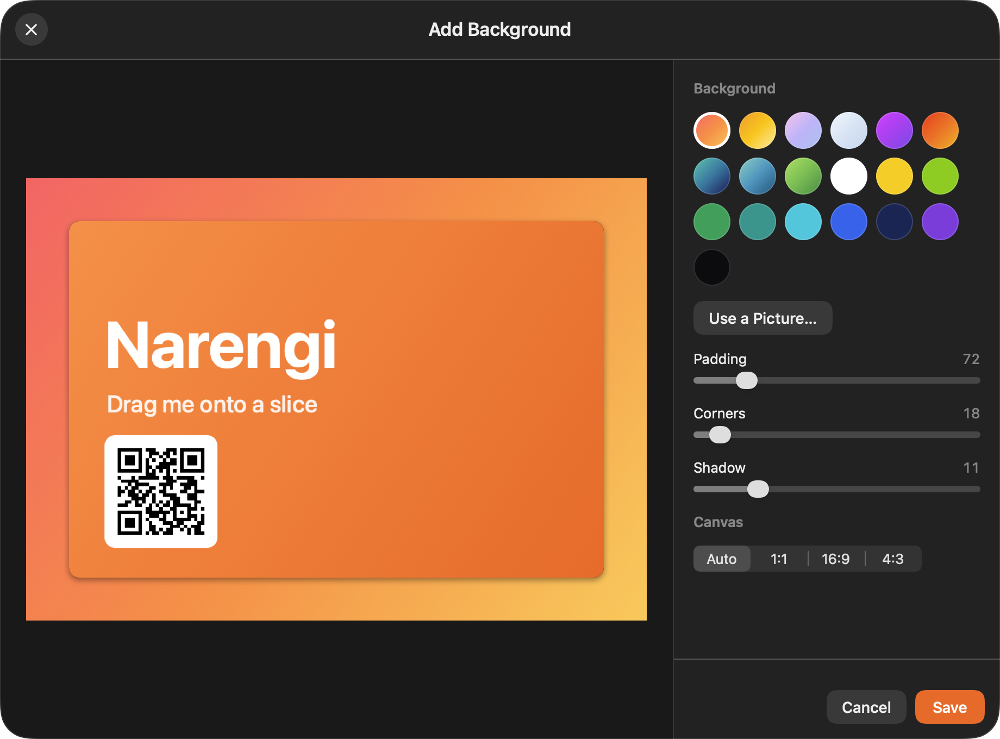
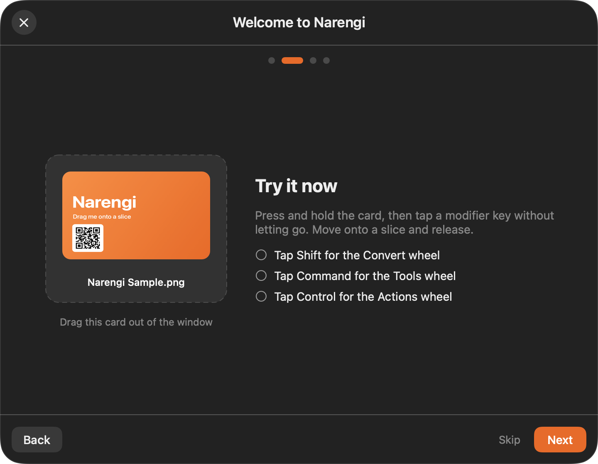

# Narengi

**Drag a file. Tap a key. Pick a slice.**

Narengi is a native macOS menu-bar app (Swift, SwiftUI and AppKit, no web views, no Electron) that turns any
file drag into a radial menu. Start dragging a file in Finder, tap a modifier key, and a wheel opens under your
pointer: drop on a slice to **convert** the file, **edit** it, or do something **quick** with it. Everything runs
on your Mac. There are no accounts, no uploads and no usage limits.

<p align="center">
  
</p>

## Features

### Conversion wheel (hold-and-tap **⇧ Shift** while dragging)
Pick a target format and the result appears next to the original. Names never collide (`photo.jpg`, then
`photo 2.jpg`) and originals are never overwritten. Only routes that work on your Mac are shown.

| Category | Formats |
|---|---|
| Images | JPG, PNG, WEBP, HEIC, TIFF, AVIF, BMP, SVG (input) |
| Documents | PDF, DOCX, RTF, RTFD, HTML, EPUB, TXT, Markdown, text clippings |
| Spreadsheets | XLSX, ODS, CSV, TSV (to each other and to PDF) |
| Audio | MP3, M4A, WAV, FLAC, OGG, OPUS, AIFF, WMA |
| Video | MP4, MOV, MKV, WEBM, AVI, WMV, GIF |
| Archives | ZIP, TAR, GZIP, RAR (extract) |
| Subtitles | SRT, VTT, TXT |

Scanned PDFs and images are read with on-device OCR (Vision), so *image → DOCX/TXT/Markdown* and
*scanned PDF → text* work too.

### Tools and editors (**⌘ Command**)
- **Compress** images, audio, video and PDFs, with a "reduce by %" slider or Balanced/Strong presets.
- **Metadata**: view, search, edit and remove it (JPG, PNG, WebP, GIF, PDF, audio, video).
- **Read QR codes** and barcodes from images and PDFs.
- **PDF**: split, merge, create from images, and a page organizer (reorder, rotate, delete).
- **Photos**: crop, add background, edit (exposure, contrast, shadows, saturation, warmth, sharpness, vignette),
  annotate, redact, collage.
- **Audio and video**: normalize volume, trim silence, mono/stereo, visualizer, trim, crop, speed, remove audio,
  snapshot, split, join, redact areas, and bleep out words.
- **Redaction is real**: covered areas are burned into the pixels (or into a flattened PDF page), so nothing underneath
  can be recovered.

<p align="center">
  
</p>

### Actions and the Float shelf (**⌃ Control**)
AirDrop, **Float** (a small always-on-top shelf you can drag files in and out of, with Quick Look), Copy, Move,
Copy Path and Open in Terminal (Terminal, iTerm, Ghostty or Warp). While a wheel is open, a *Drop files here*
tile at the top-right of the screen sends files straight to a Float.

### Keyboard mode
Prefer not to drag? Choose **Convert Files…** from the menu-bar item, pick files, and use the arrow keys (or the
mouse) to choose a slice. Press the modifier keys to switch between the three wheels.

### Make it yours
Every modifier is configurable. Settings cover appearance (glass or solid), launch at login, feedback, output
location, per-format quality, and your terminal app. A welcome guide with a practice file opens on first launch and
any time from **Welcome Guide…** in the menu.

<p align="center">
  
</p>

## Install

Requires an Apple silicon Mac running macOS 14 or later.

1. Download `Narengi-<version>-arm64.dmg` from the [Releases page](https://github.com/ImanMontajabi/Narengi/releases).
   Optionally check it against the `.sha256` file next to it: `shasum -a 256 -c Narengi-<version>-arm64.dmg.sha256`.
2. Open the disk image and drag **Narengi.app** onto **Applications**.
3. The app is signed ad hoc (not notarized), so macOS will quarantine it. Clear that once, then open it:

   ```sh
   xattr -cr /Applications/Narengi.app
   open /Applications/Narengi.app
   ```

Narengi lives in the menu bar. If your menu bar is crowded (for example on a notched MacBook) the icon can be
pushed out of sight; the app then opens its settings so it stays reachable, and you can free some space by
⌘-dragging other icons away.

## Build from source

You need a current Xcode (the project is built with the latest macOS SDK and targets macOS 14), [XcodeGen](https://github.com/yonaskolb/XcodeGen) and Homebrew's `ffmpeg`.

```sh
brew install xcodegen ffmpeg create-dmg gh

git clone https://github.com/ImanMontajabi/Narengi.git && cd Narengi
scripts/setup-vendor.sh      # downloads cwebp and ExifTool (checksum-pinned) into Narengi/Resources/Vendor
scripts/bundle-ffmpeg.sh     # copies Homebrew's ffmpeg and its libraries into the bundle, relinked and signed
xcodegen generate            # creates Narengi.xcodeproj from project.yml (the source of truth)
open Narengi.xcodeproj       # or build from the command line:

xcodebuild -project Narengi.xcodeproj -scheme Narengi -destination 'platform=macOS,arch=arm64' test
```

| Script | What it does |
|---|---|
| `scripts/setup-vendor.sh` | Fetches `cwebp` and ExifTool, verifying pinned SHA-256 hashes. |
| `scripts/bundle-ffmpeg.sh` | Makes the self-contained `ffmpeg` (plus its dylibs) the app ships with. |
| `scripts/release.sh` | Builds Release, signs the tools and the app, installs to `/Applications`. `--no-install` stops after signing. |
| `scripts/package-dmg.sh` | Builds the styled `dist/Narengi-v<version>-arm64.dmg` and its `.sha256`. |
| `scripts/publish-release.sh vX.Y.Z` | Tests, packages, tags, pushes and publishes a GitHub release with the DMG. |

The app also works without the bundled tools: it finds Homebrew's `ffmpeg`, `cwebp` and `exiftool` if they are installed.
Tools that need a missing helper are simply hidden from the wheels.

## Notes

- Not implemented yet, and hidden from the wheels: Pages and PowerPoint output, PDF → XLSX, legacy `.xls` input.
- The bundled FFmpeg build is **GPL**, so redistributing the app with it carries GPL obligations. See
  [`THIRD_PARTY_NOTICES.md`](THIRD_PARTY_NOTICES.md).
- Design notes and how the pieces fit together: [`docs/ARCHITECTURE.md`](docs/ARCHITECTURE.md).

Narengi is an independent project. It is inspired by the idea behind *Tangerine: File Converter* and is not
affiliated with or endorsed by its makers. Parts of its behaviour are ported from the MIT-licensed
[Satsuma](https://github.com/sonatina-dream/satsuma) project; attributions and the licenses of every bundled component are in
[`THIRD_PARTY_NOTICES.md`](THIRD_PARTY_NOTICES.md).

## License

[MIT](LICENSE) © 2026 Iman Montajabi
